# CydLan feature showcase

Every screenshot here was rendered by CydLan's own offline preview mode (`--screenshot`) from the current source. The contacts and messages are sample data.

[Download CydLan](https://github.com/MonsterHammer/Cyd-Lan-Messenger/releases/latest) · [Works with LAN Messenger](lan-messenger-compatibility.md)

## Chat

Direct chat with delivery receipts, typing indicators, profile pictures, and search.

| Light | Dark |
| --- | --- |
| 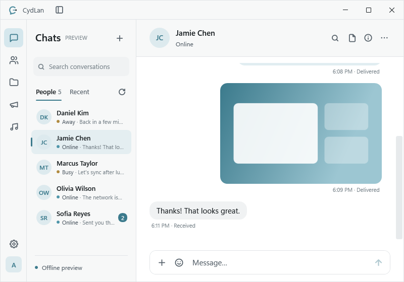 | 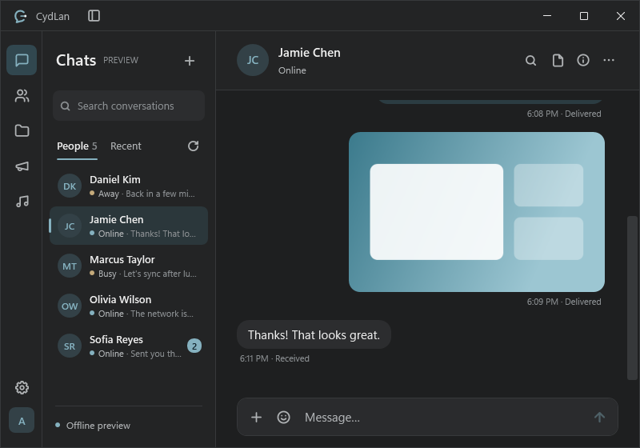 |

## Group rooms

Group rooms work with LAN Messenger 1.2.39 users too.

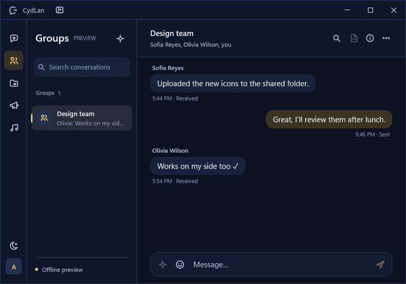

## File transfers

Send and receive files and folders, with progress, accept or decline, and a Files view for everything sent and received.

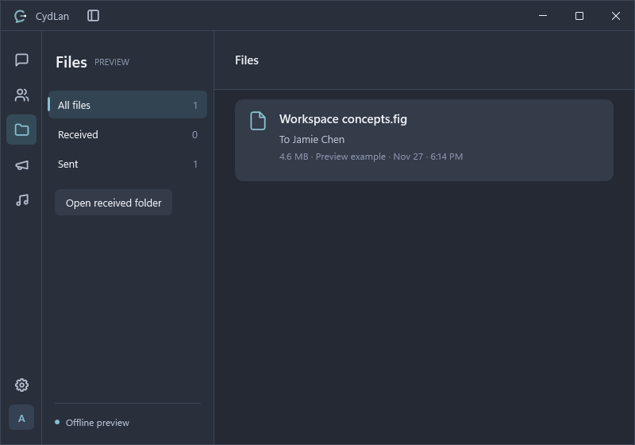

## Themes

45 built-in themes, each with its own palette. Some themes add decorations and effects, and you can switch between them live.

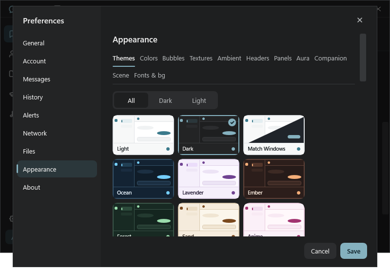

| Sakura | Cyberpunk |
| --- | --- |
| 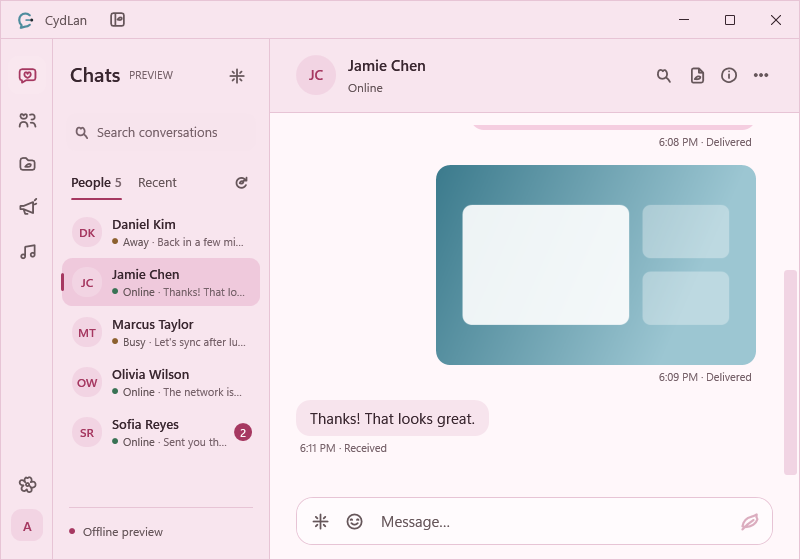 | 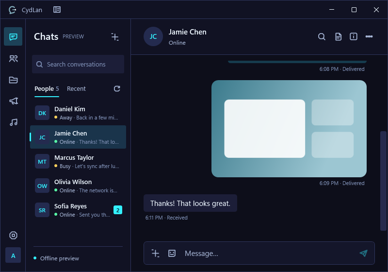 |
| **Steampunk** | **Forest** |
| 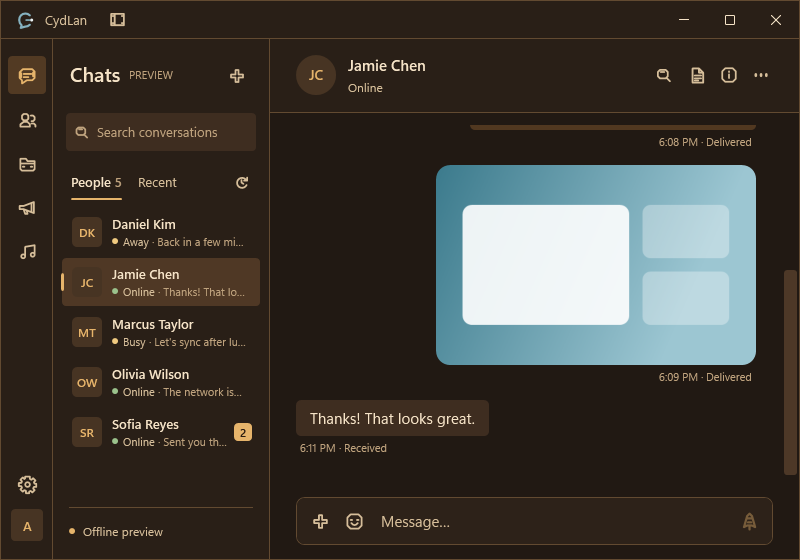 | 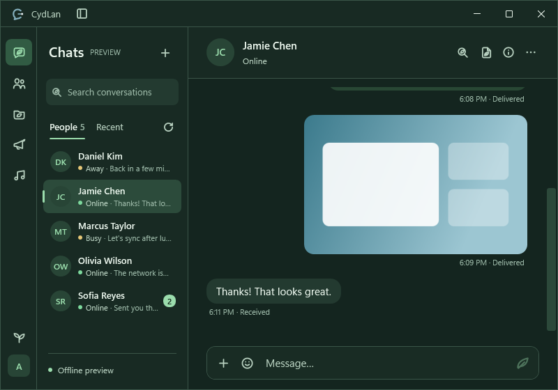 |
| **Synthwave** | **Paper** |
| 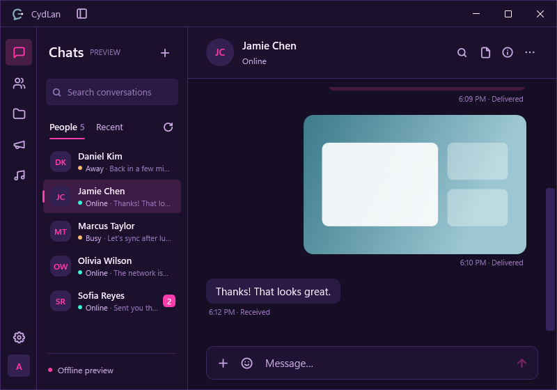 | 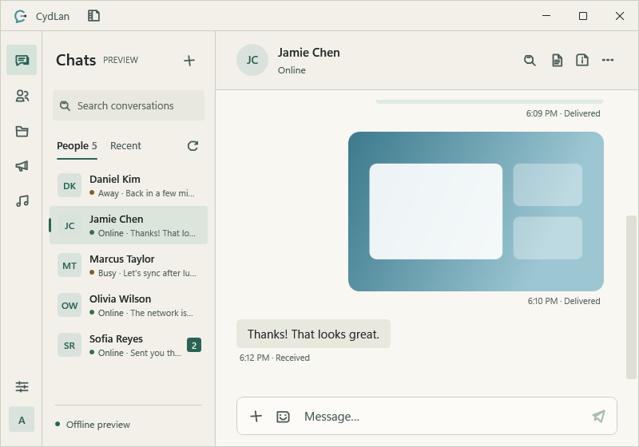 |

**Theme list:** Light, Dark, Match Windows, Ocean, Lavender, Ember, Forest, Sand, Anime, Sakura, Steampunk, Aurora, Paper, Arcade, Pixel, Cyberpunk, Midnight, Sunset, Mint, Matcha, Frost, Obsidian, Nord, Synthwave, Crimson, Emerald, Rose, Espresso, Cobalt, Sage, Amber, Pineapple Sea, Coral Star, Noir Pink, Vampire, Volt Spark, Kingdom Red, Bubblegum, Ribbon Blush, Noir Gold, Web Crimson, Jester, Cipher, Freedom Wings, Arc Reactor.

## Fine-tune every region

Colors, chat bubbles, textures, headers, panels, aura glow, fonts, and chat backgrounds can each be changed separately, with an HSV color picker for each region. A whole look can be shared as a Look code.

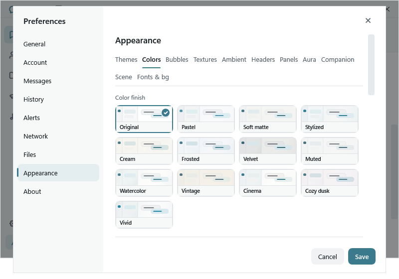

## Floating companion

A desktop companion that floats above your other windows. It can roam the screen, hop, and open CydLan when clicked. Build your own from the parts below, or press **Randomize**.

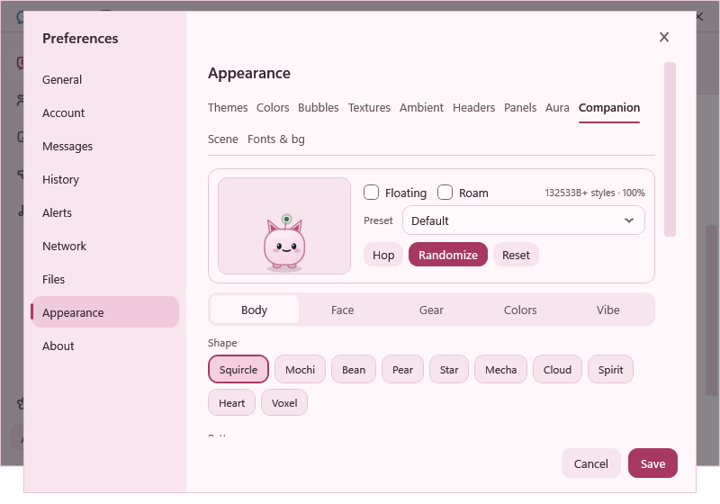

**Presets:** Default, Mecha Ace, Barista, Wizard, Angel, Imp, Cyber DJ, Sakura, Monarch, Spirit, Chef, Knight, Shark, Puppy, Gamer.

| Part | Options |
| --- | --- |
| Body | Squircle, Mochi, Bean, Pear, Star, Mecha, Cloud, Spirit, Heart, Voxel |
| Ears | Theme, Cat, Bunny, Bear, Fox, Puppy, Elf, Horns, Antlers, V-fin, Axolotl, None |
| Eyes | Glossy, Kawaii, Cat, Starry, Heart, Sparkle, Visor, Chill, Wink, Comfy, Dizzy, Plush |
| Brows | Clean, Arched, Upbeat, Fierce, Puppy, Unibrow, Bold |
| Mouth | Smile, OwO, Grin, Fang, Blep, Smirk, Cute :3, Beak, Pout, Dapper, Quiet |
| Cheeks | Rosy, Freckles, Whiskers, Anime, Hearts, Stars, Clean |
| Glasses | None, Round, Shades, Star shades, Monocle, Goggles, Eyepatch |
| Hat | Theme, None, Antenna, Sprout, Halo, Crown, Cap, Beanie, Wizard, Headset, Bow, Beret, Top hat, Chef, Flower |
| Outfit | Theme, Bow tie, Scarf, Hoodie, Necktie, Apron, Armor, Star badge, Heart gem, Arc core, Plain |
| Back | None, Angel wings, Bat wings, Fairy wings, Thrusters, Jetpack, Cape, Fluffy tail, Shell, Shark fin |
| Prop | None, Sparkles, Hearts, Notes, Flames, Orbit ring, Coffee, Star wand, Balloon, Gamepad, Lantern |
| Aura | None, Halo ring, Rays, Neon glow, Petals, Bubbles, Star ring |
| Feet | Paws, Boots, Sneakers, Hover, Rollers, None |
| Pattern | Clean, Belly, Ombre, Spots, Tabby, Cosmic, Tuxedo, Cyber |
| Vibe | Bouncy, Chill, Zoomies, Sleepy |

Body, accent, and detail colors and size can be adjusted too. A companion can be saved and shared.

## Scene effects

Drag animated decorations onto any part of the window: the chat area, side content, header, side navigation, or title bar.

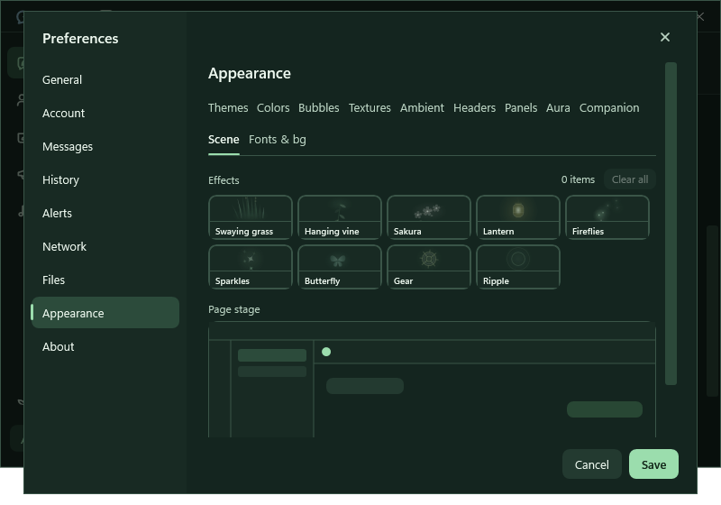

**Effects:** Swaying grass, Hanging vine, Sakura, Lantern, Fireflies, Sparkles, Butterfly, Gear, Ripple.

## Ambient effects

Falling petals, fireflies, rain, snowfall, ink bloom, send pulse, and the title-bar engine. Each follows the active theme's palette and has its own intensity control.

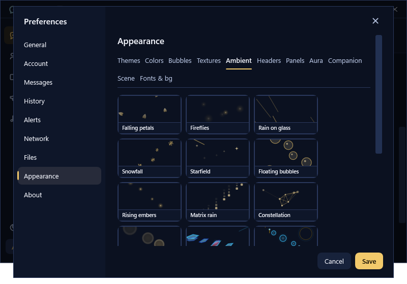

## Network and system tray

Connect by IP when discovery is blocked, see connection diagnostics, and open logs. Closing the window keeps CydLan in the tray.

| Network | Tray menu |
| --- | --- |
| 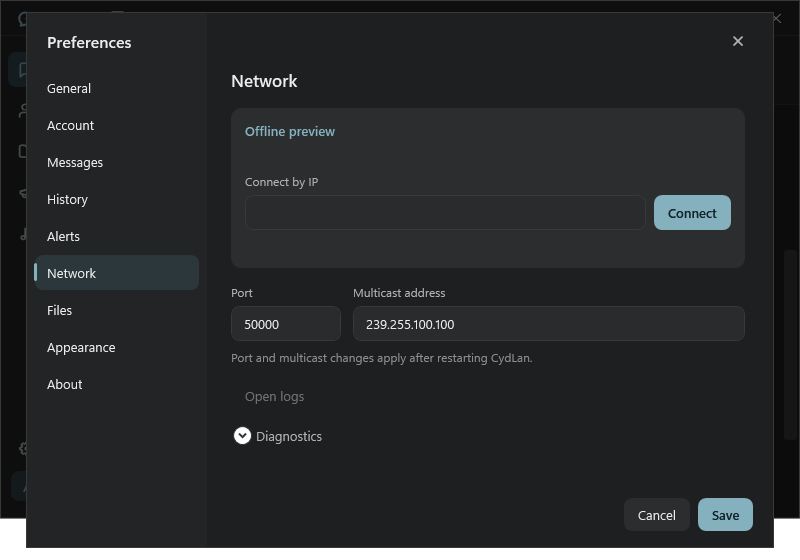 | 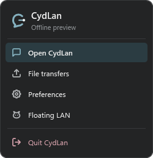 |
